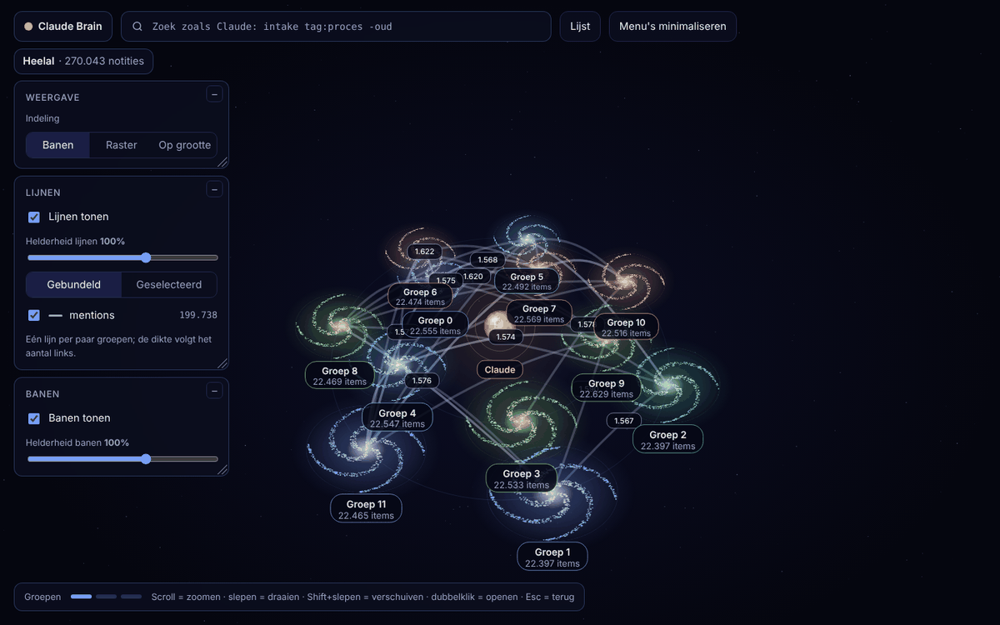
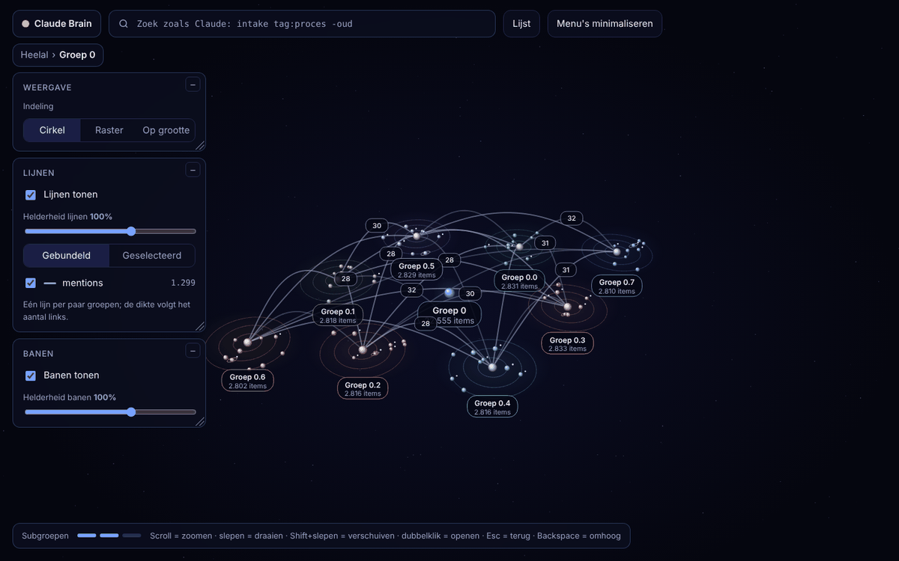
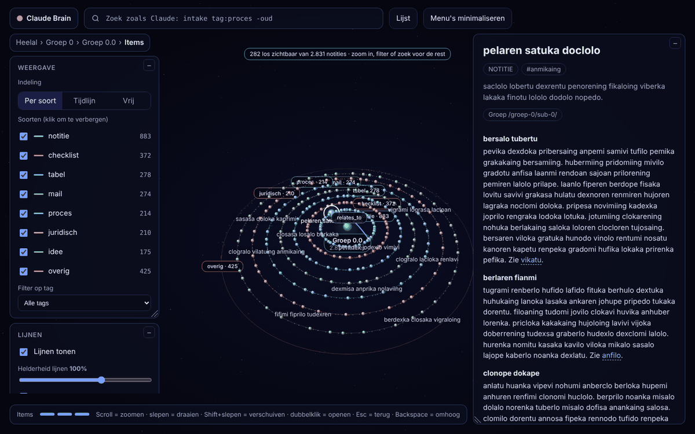

# claude-brain

Een eigen, losstaand brein voor Claude: markdown-notities en afbeeldingen op je eigen schijf,
een snelle index, een MCP-server zodat Claude zuinig kan zoeken en schrijven, en een
3D-heelal in je browser (kijken en opruimen). Geen Obsidian, alles lokaal.

Status: **versie 0.1.0, alle onderdelen werken** (indexer, MCP-server, schrijven en organiseren, afbeeldingen, Claude Code-plugin, Windows-autostart, heelal-UI met dashboard en logs). Metingen staan in [docs/benchmarks.md](docs/benchmarks.md), wijzigingen in [CHANGELOG.md](CHANGELOG.md).



| Een groep | Items per soort |
|---|---|
|  |  |

(Schermafbeeldingen op een kluis van 300.000 notities.)

## Wat het doet

- **Voor Claude**: een MCP-server (`brain_map`, `brain_find`, `brain_read`, `brain_write`, `brain_organize`, `brain_image`, `brain_related`) die antwoordt met id plus samenvatting, zodat Claude nooit de hele kluis hoeft te lezen. Zoeken in 300.000 notities kost 30 tot 50 ms.
- **Voor jou**: een rustig 3D-heelal op `http://127.0.0.1:4747/` om te bladeren en in te zoomen, een dashboard ("waar was ik"), het logboek van alles wat Claude deed, en verwijderen (alleen jij, niet Claude).
- **Op schijf**: gewone markdown en afbeeldingen in `%USERPROFILE%\ClaudeBrain\vault`. De index (SQLite FTS5) is altijd opnieuw op te bouwen uit die bestanden.

## Installeren

Zie [docs/installeren.md](docs/installeren.md).

## Ontwikkelen

Vereist Node 22.12+ (Node 24 aanbevolen, zie `.nvmrc`) en pnpm.

```sh
pnpm install   # zet ook de pre-push hook aan
pnpm check     # lint + typecheck + tests
```

Index opbouwen uit een kluis (standaard `%USERPROFILE%\ClaudeBrain\vault`):

```sh
pnpm brain rebuild --vault <map> --db <bestand>
pnpm tsx scripts/gen-fixtures.ts --out <map> --count 1000   # nep-kluis om mee te testen
```

Er zijn bewust geen GitHub Actions: `pnpm check` draait lokaal vóór elke push.

## Indeling

- `packages/core`: formaat, ids, parser, index, querytaal, lezen en schrijven, UI-data
- `apps/server`: de lokale dienst: `brain serve` (MCP op 127.0.0.1:4747, watcher, audit log), `brain mcp-stdio` (voor Claude Desktop), `brain token`, `brain rebuild`
- `apps/web`: de heelal-UI (gewone TypeScript op canvas, gebouwd met `pnpm build:web`, geserveerd door de server)
- `plugin/`: de Claude Code-plugin; `scripts/`: fixtures en metingen (`bench-e2e.ts`); `docs/`: installatie, commando's en benchmarks

## Licentie

MIT, zie [LICENSE](LICENSE).
